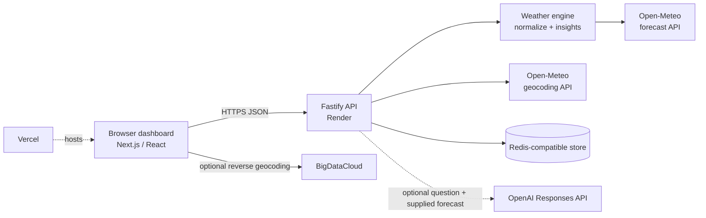

# Architecture

Weather Universe is a pnpm monorepo. The browser-facing Next.js app calls a separate Fastify API; the API talks to weather and geocoding providers and can use Redis for shared weather caching and rate limits.

## System overview

The diagram describes runtime connections. The AI integration is optional and is unavailable when `OPENAI_API_KEY` is not configured. The browser's reverse-geocoding request is only used after location permission has been granted.

## Repository map

| Path | Responsibility |
| --- | --- |
| `apps/web` | Next.js dashboard, condition-aware presentation, location and unit preferences, API client, component and Playwright tests |
| `apps/api/src/server.ts` | Fastify setup, CORS, security headers, sanitized error responses, health/readiness endpoints, startup and graceful shutdown |
| `apps/api/src/modules/weather` | Weather routes, cache integration, weather insight endpoint |
| `apps/api/src/modules/location` | City search route and Open-Meteo geocoding adapter |
| `apps/api/src/modules/ai` | Strictly validated weather-question endpoint and optional OpenAI client |
| `apps/api/src/plugins` | Redis connection lifecycle and shared/local rate limiting |
| `packages/types` | Shared weather response interfaces |
| `packages/weather-engine` | Open-Meteo client, response normalization, weather calculations, insights |
| `packages/recommendation-engine` | Activity scoring modules for recommendation features |

## Weather request flow

1. The web app loads the saved location, or asks the browser for location permission and resolves coordinates to a place name. Lagos is the fallback location.
2. The web app requests `/weather` and `/weather/insights` in parallel for the selected coordinates.
3. The API checks its weather cache. A fresh entry is returned immediately; otherwise, the API requests Open-Meteo and normalizes provider data into the shared `WeatherData` shape.
4. Successful provider data is cached for five minutes and retained as stale fallback data for up to 30 minutes. Concurrent requests for the same coordinates share one provider request per API process.
5. If fresh data is unavailable and the provider fails, stale data can be served when present. The response includes `X-Weather-Cache: stale` so the caller can distinguish it.
6. The web app renders condition-specific visual styling and derives the outdoor planner's suggested time windows from the hourly forecast.

The Redis cache is shared across API instances. A bounded in-process cache and in-flight request map provide local fallback and deduplication. Redis rate limits use atomic increments with an expiry; local development uses per-process in-memory counters.

## Reliability and operations

- `GET /health` is a liveness check.
- `GET /health/ready` is a readiness check. In production it returns `503` if the configured shared Redis store is not ready.
- Fastify logs request activity and structured startup, shutdown, provider/cache, and error events.
- `SIGTERM` and `SIGINT` trigger a one-time Fastify close, which drains active requests and closes the Redis connection.
- Weather and frontend GET requests use bounded retries for transient errors; the Open-Meteo forecast client validates provider response fields before normalization.
- GitHub Actions runs quality checks and, for pushes/manual runs on `main`, production smoke probes and a live browser journey.

## Runtime configuration

- `FRONTEND_URL` is a required production API setting containing the exact allowed HTTPS frontend origin(s).
- `REDIS_URL` is required in production for shared rate limiting and the shared weather cache.
- `NEXT_PUBLIC_API_URL` points the web build to the deployed API.
- `OPENAI_API_KEY` is optional and belongs only in the API environment.

See the root [README](../README.md) for local setup and [API.md](API.md) for routes and payloads.
